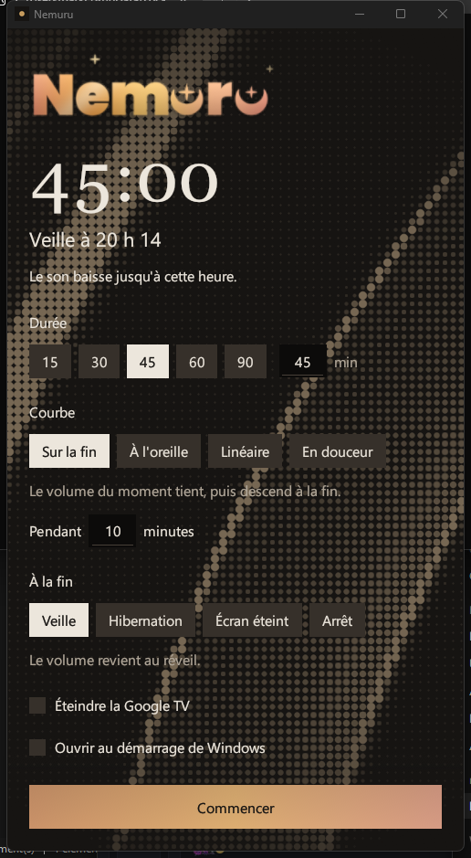
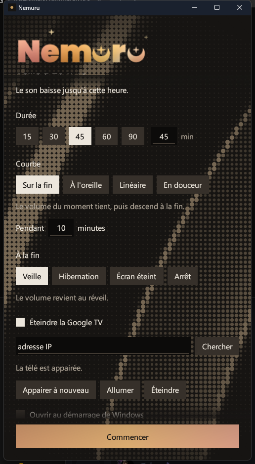
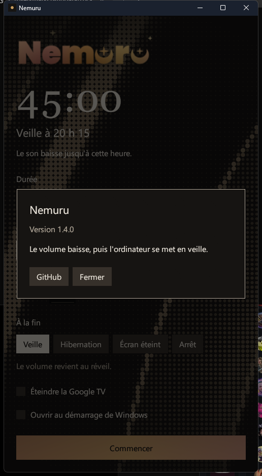

<p align="center">
  
</p>

<p align="center"><b>Le son baisse. Puis l'ordinateur s'endort.</b></p>

<p align="center">
  <a href="https://github.com/t12lve/nemuru/releases/latest"></a>
  
  <a href="LICENSE.txt"></a>
  <a href="https://t12lve.github.io/nemuru/"></a>
</p>

<p align="center">
  <a href="https://github.com/t12lve/nemuru/releases/latest"><b>Télécharger</b></a> ·
  <a href="https://t12lve.github.io/nemuru/">Site</a> ·
  <a href="#nouveautés-de-la-140">Nouveautés</a> ·
  <a href="#utilisation">Mode d'emploi</a>
</p>

Nemuru est une minuterie de coucher pour Windows. On choisit une durée, le volume descend tout doucement, puis l'ordinateur passe en veille, en hibernation, éteint l'écran ou s'arrête. Une Google TV appairée s'éteint avec lui.

<p align="center">
  
</p>

<p align="center"><i>Pendant le compte, le logo sert de barre de progression : la lumière gagne les lettres de gauche à droite.</i></p>

<table>
  <tr>
    <td></td>
    <td></td>
    <td></td>
  </tr>
  <tr>
    <td align="center">La fenêtre</td>
    <td align="center">La Google TV</td>
    <td align="center">À propos</td>
  </tr>
</table>

## Sommaire

- [Installation](#installation)
- [Nouveautés de la 1.4.0](#nouveautés-de-la-140)
- [Utilisation](#utilisation)
- [Clavier et souris](#clavier-et-souris)
- [Le volume](#le-volume)
- [À la fin](#à-la-fin)
- [Google TV](#google-tv)
- [Mise à jour automatique](#mise-à-jour-automatique)
- [Confidentialité](#confidentialité)
- [Fichiers](#fichiers)
- [Le site](#le-site)
- [Compilation](#compilation)
- [Organisation du code](#organisation-du-code)
- [Licence](#licence)

## Installation

Windows 10 ou 11, 64 bits.

1. Télécharger `Nemuru_Setup_v1.4.0.exe` sur la [page des releases](https://github.com/t12lve/nemuru/releases/latest).
2. Lancer l'installeur. Il s'installe pour l'utilisateur courant, sans droits d'administrateur.
3. Nemuru s'ouvre à la fin de l'installation.

L'installeur n'est pas signé. Windows SmartScreen peut afficher « Windows a protégé votre ordinateur » : **Informations complémentaires**, puis **Exécuter quand même**.

La désinstallation passe par les paramètres de Windows. Elle retire aussi les réglages et le journal.

## Nouveautés de la 1.4.0

**Un logo vivant.**
- Le logo remplace le nom en haut de la fenêtre et occupe plus de la moitié de la largeur.
- Il est peint en lumière de fin de journée : ambre, or, pêche et rose glissent lentement, un reflet le traverse toutes les dix secondes environ, les étoiles scintillent.
- Pendant le compte, il sert de barre de progression. La lumière gagne les lettres de gauche à droite, un liseré clair marque le front, le reste attend dans l'ombre. Sans compte en cours, il est plein.
- Un clic dessus ouvre le menu : **À propos**, **GitHub**, **Quitter**.

**Une fenêtre plus fluide.**
- **Commencer** reste toujours visible en bas de la fenêtre, quelle que soit la hauteur du formulaire.
- Survols, sélections et cases cochées se font en fondu. Les sections **Pendant** et **Google TV** se déplient en glissant. Les fenêtres À propos et Sur le réseau apparaissent et disparaissent en fondu.
- L'horloge défile jusqu'à la nouvelle durée au lieu de sauter.
- Le texte qui défile s'efface sur les bords au lieu d'être coupé net.
- Les champs de saisie se distinguent des boutons : fond creusé, filet qui s'éclaire au focus.
- Le fond animé passe de 15 à 30 images par seconde, tout en consommant moins qu'avant.

**Plus simple à utiliser.**
- La durée personnalisée est sur la même ligne que les raccourcis 15, 30, 45, 60 et 90.
- Sur un clavier AZERTY, la rangée du haut tape des chiffres sans Maj ni Verr. Maj.
- La section Google TV tient en trois lignes : adresse et **Chercher**, état, puis **Appairer**, **Allumer** et **Éteindre**.
- **Chercher** ouvre une fenêtre à part : une ligne par appareil, l'adresse IPv4 en priorité, les adresses trop longues abrégées.
- Un clic à côté ferme À propos et Sur le réseau. Il n'interrompt jamais un appairage en cours.
- **Fermer** est un vrai bouton, facile à atteindre.

**Pendant le compte.**
- La fenêtre se range près de l'horloge dès que le compte commence. Elle quitte la barre des tâches et Alt+Tab.
- Le curseur de volume de Windows reste libre. La baisse est un pourcentage du niveau du moment : si l'on monte ou baisse le son, Nemuru repart de là.
- La courbe par défaut devient **Sur la fin**.

**Appairage par téléphone.**
- Un code QR ouvre une page servie par Nemuru sur le réseau de la maison. Le téléphone y saisit le code affiché par la télé. Le code ne passe pas par Internet.

## Utilisation

La fenêtre s'ouvre sans rien lancer. Le compte à rebours commence seulement avec **Commencer**.

1. Choisir une durée. Les raccourcis sont 15, 30, 45, 60 et 90 minutes. Le champ à côté accepte une valeur de 1 à 480.
2. Choisir la courbe de baisse, puis l'action de fin.
3. **Commencer**.

L'heure affichée sous le compte est le moment où l'action aura lieu, par exemple « Veille à 23 h 40 ».

Quand le compte commence, la fenêtre se range dans la zone de notification. L'icône reste ; son info-bulle donne le temps restant. Un clic gauche rouvre la fenêtre, et son menu propose **Ouvrir**, **Annuler** et **Quitter**. Dans la fenêtre, le logo se remplit à mesure que le temps passe et le volume du moment s'affiche sous l'horloge.

**Annuler**, **Échap** et **Quitter** remettent le volume de départ. Une seconde fenêtre ne s'ouvre pas : un message prévient que Nemuru est déjà lancé.

Tant que le compte tourne, Windows ne s'endort pas de lui-même. Cet état d'éveil est relâché juste avant l'action finale.

Les réglages sont enregistrés au fil de l'eau. La case **Ouvrir au démarrage de Windows** ajoute Nemuru au démarrage de la session. Au login, seule la fenêtre s'ouvre ; le compte ne démarre pas tout seul.

## Clavier et souris

| Geste | Effet |
| --- | --- |
| **Échap** | Ferme la fenêtre ouverte par-dessus (À propos, Sur le réseau, appairage). Sinon, annule le compte en cours. |
| Clic sur le logo | Ouvre le menu : À propos, GitHub, Quitter. |
| Clic à côté d'une fenêtre | Ferme À propos ou Sur le réseau. |
| Rangée des chiffres AZERTY | `&é"'(-è_çà` donnent `1234567890` dans les champs de durée. |
| **Tab** | Passe d'un réglage à l'autre ; le focus est entouré de laiton. |
| Clic gauche sur l'icône | Rouvre la fenêtre pendant le compte. |
| Fermer la fenêtre | Sans compte : quitte. Pendant le compte : range la fenêtre près de l'horloge. |

## Le volume

Nemuru agit sur le volume principal, celui du curseur de la barre des tâches. Il mémorise le niveau et l'état muet au départ, puis les remet dans les cas décrits plus bas.

| Courbe | Ce qu'on entend |
| --- | --- |
| Sur la fin | Le volume du moment tient, puis descend pendant les dernières minutes. C'est le réglage de départ. Le champ **Pendant** indique combien. |
| À l'oreille | La baisse semble régulière. Le niveau descend de façon linéaire en décibels, de 0 dB à −60 dB. |
| Linéaire | Le pourcentage descend d'un pas égal chaque minute. |
| En douceur | La baisse commence lentement, s'accélère, puis se termine lentement. |

La baisse est un pourcentage du niveau du moment. Si l'on touche au curseur de Windows pendant le compte, Nemuru prend ce nouveau niveau comme base et continue la courbe à partir de là, sans ramener le curseur en arrière.

## À la fin

| Action | Ensuite |
| --- | --- |
| Veille | Le volume revient au réveil. |
| Hibernation | Le volume revient à la sortie d'hibernation. |
| Écran éteint | Le son reste coupé. **Rétablir le son** le remet, de même que quitter l'application. |
| Arrêt | L'ordinateur s'éteint. Le volume n'est pas remis avant l'arrêt. |

## Google TV

L'extinction de la télé est décochée au départ. Il faut une adresse sur le même réseau.

- **Chercher** ouvre la fenêtre « Sur le réseau » et interroge le réseau en mDNS. Chaque appareil Cast apparaît sur une ligne : le nom à gauche, l'adresse à droite. Un clic choisit l'appareil.
- **Appairer** affiche un code QR. Le téléphone ouvre une page servie par Nemuru lui-même, sur le réseau de la maison. Ensuite, **Afficher le code sur la télé** lance l'appairage : la télé quitte l'image de l'ordinateur et montre un code à six caractères. On le saisit sur le téléphone, ou au clavier de l'ordinateur, qui reste à l'écoute même si l'image a changé de source.
- Une fois le code accepté, Nemuru envoie la touche d'alimentation de la télécommande Android, environ trente secondes avant la fin du compte.
- **Éteindre** envoie cette touche tout de suite. **Allumer** envoie la touche de réveil si la télé répond encore, sinon un signal de réveil sur le réseau local.

Une Google TV refuse souvent l'ordre Cast `STANDBY`, d'où l'appairage. Sans appairage, l'ordre Cast est tout de même essayé. Si la télé ne répond pas, l'action choisie pour l'ordinateur a quand même lieu.

À la première ouverture de la page du téléphone, Windows peut demander d'autoriser Nemuru sur le réseau. Cocher **réseau privé** seulement.

Pourquoi une page locale et pas un site en ligne : une page publiée en HTTPS, comme GitHub Pages, ne peut pas parler à un appareil du réseau local en HTTP ; les navigateurs bloquent ce mélange. Et le code de la télé n'a rien à faire sur Internet.

## Mise à jour automatique

Au lancement, la version publiée de Nemuru compare sa version à la dernière release de ce dépôt. Si une version plus récente existe, l'installeur est téléchargé, puis lancé dès qu'aucun compte n'est en cours. La fenêtre se ferme, l'installation se fait sans fenêtre, puis Nemuru se rouvre.

## Confidentialité

- Pas de compte, pas de statistiques, pas de publicité.
- La seule requête vers Internet est la vérification de version auprès de l'API GitHub, et le téléchargement de l'installeur s'il y a une mise à jour.
- L'adresse de la télé, son identité matérielle, le certificat d'appairage et le journal restent dans `%APPDATA%\Nemuru`.
- Le code d'appairage passe du téléphone à l'ordinateur sur le réseau de la maison, par une adresse à jeton unique, puis le serveur s'arrête.

## Fichiers

| Fichier | Contenu |
| --- | --- |
| `%APPDATA%\Nemuru\config.json` | Réglages : durée, courbe, action, télé, démarrage. |
| `%APPDATA%\Nemuru\nemuru.log` | Journal. |
| `%APPDATA%\Nemuru\atv.p12`, `atv-key.pem`, `atv.ok` | Identité d'appairage avec la télé. |

Un ancien fichier `%APPDATA%\SommeilDouceur\config.json` est repris au premier lancement.

## Le site

La page d'accueil est publiée par GitHub Pages depuis le dossier `docs/` de la branche `main` : [t12lve.github.io/nemuru](https://t12lve.github.io/nemuru/). Elle reprend les couleurs de l'application et ne contient aucun script.

## Compilation

Rust stable :

```
cargo build --release
```

L'exécutable est `target\release\nemuru.exe`. Le logo `logonemuru.png` est intégré à l'exécutable à la compilation ; `logonemuru.svg` en est la version source.

L'installeur se construit avec [Inno Setup 6](https://jrsoftware.org/isinfo.php) :

```
build.bat
```

ou, si le compilateur est déjà dans le chemin habituel :

```
"C:\Program Files (x86)\Inno Setup 6\ISCC.exe" installer\installer.iss
```

Le fichier produit est `dist-installer\Nemuru_Setup_v1.4.0.exe`.

Les tests ne touchent ni au son, ni à la veille, ni à la télé :

```
cargo test
```

Ils couvrent les courbes de volume, la reprise du curseur pendant le compte, la page d'appairage du téléphone, la conversion des chiffres AZERTY, le dédoublonnage des appareils, le relief du fond, les couleurs et le remplissage du logo, et le contraste du texte sur le bouton **Commencer**. Deux tests de télé réelle sont ignorés par défaut ; ils lisent `NEMURU_TV` et `NEMURU_TV_MAC` dans l'environnement.

Pour voir le logo à un autre niveau de remplissage sans lancer de vrai compte, le build de développement lit `NEMURU_APERCU` (de 0 à 1). La version publiée l'ignore.

```
set NEMURU_APERCU=0.4
cargo run
```

## Organisation du code

| Fichier | Rôle |
| --- | --- |
| `src/main.rs` | Démarrage et journal. |
| `src/instance.rs` | Une seule instance à la fois. |
| `src/mark.rs` | Icône de la fenêtre et de la zone de notification. |
| `src/ui.rs` | Fenêtre, formulaire, menu, fenêtres par-dessus, icône de notification. |
| `src/logo.rs` | Logo animé et barre de progression. |
| `src/waves.rs` | Fond en trame de points sur des plis de soie. |
| `src/session.rs` | Compte à rebours, baisse du volume, action de fin. |
| `src/fade.rs` | Courbes de volume et reprise du curseur. |
| `src/audio.rs` | Volume principal de Windows. |
| `src/power.rs` | Veille, hibernation, écran éteint, arrêt. |
| `src/google_tv.rs` | Recherche mDNS et ordres Cast. |
| `src/atv.rs` | Télécommande Android TV : appairage, alimentation, réveil. |
| `src/pair_page.rs` | Page locale et code QR pour le téléphone. |
| `src/pair_keys.rs` | Saisie du code au clavier pendant que la télé occupe l'écran. |
| `src/update.rs` | Mise à jour depuis les releases GitHub. |
| `src/config.rs` | Réglages. |
| `src/startup.rs` | Ouverture au démarrage de Windows. |
| `docs/` | Site GitHub Pages et images de ce fichier. |

## Licence

MIT. Le texte est dans `LICENSE.txt`.
